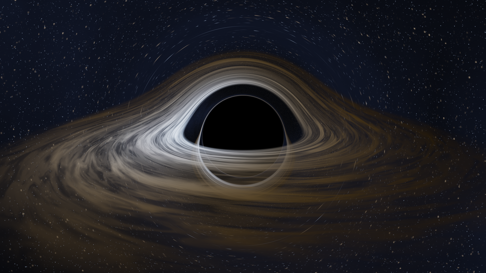
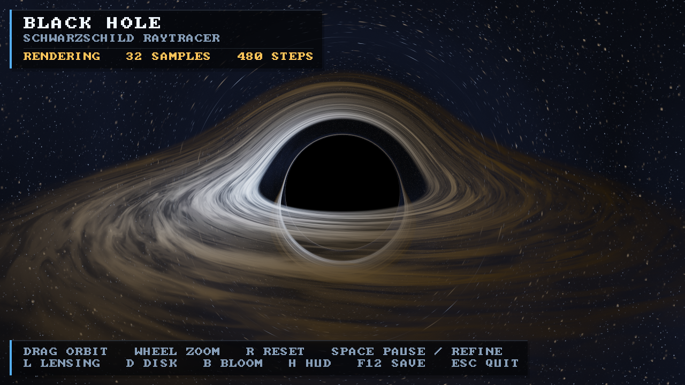

# Black Hole

A real-time, GPU-accelerated **Schwarzschild black hole** simulation in C++.
Every pixel is a camera ray integrated through curved spacetime, so the accretion
disk, photon ring and background stars are gravitationally lensed rather than
faked with a screen-space distortion.



The renderer is dependency-light: C++20, OpenGL 3.3 and GLFW, with all imagery
generated procedurally in shaders.

## Highlights

- Null geodesics integrated with RK4 in the Schwarzschild photon-orbit equation
- Event-horizon capture and higher-order disk images around the photon ring
- Thin accretion disk from `3 rs` to `13 rs` with Keplerian shear and procedural turbulence
- Blackbody disk colour with gravitational redshift and relativistic Doppler beaming
- Lensed procedural starfield with a faint galactic band
- Progressive jittered refinement while paused
- HDR accumulation, bloom, ACES filmic tonemapping and exposure control
- Orbit camera, shader hot reload, clean screenshots and an optional compact HUD
- Offscreen still and benchmark modes



## Build

Requirements:

- CMake 3.25 or newer
- A C++20 compiler
- OpenGL 3.3-capable GPU and driver
- Git and an internet connection for the first configure (GLFW is fetched by CMake)

### Windows

From a normal terminal:

```bat
cmake -S . -B build
cmake --build build --config Release
build\Release\blackhole.exe
```

Or run `build.bat`, then launch the printed executable path.

### Linux

```bash
sudo apt install build-essential cmake libgl1-mesa-dev xorg-dev
cmake -S . -B build -DCMAKE_BUILD_TYPE=Release
cmake --build build -j
./build/blackhole
```

macOS should also work with the CMake/Xcode toolchain, but is not tested here.

## Controls

| Input | Action |
| --- | --- |
| Drag | Orbit the camera |
| Mouse wheel | Zoom |
| `Space` | Pause and progressively refine |
| `R` | Reset the view |
| `L` | Toggle gravitational lensing (A/B comparison) |
| `D` | Toggle the accretion disk |
| `B` | Toggle bloom |
| `H` | Toggle the HUD |
| `[` / `]` | Exposure down / up |
| `,` / `.` | Decrease / increase ray-step budget |
| `-` / `=` | Decrease / increase render scale |
| `F5` | Hot-reload shaders |
| `F12` | Save a clean screenshot (no HUD) as BMP |
| `Esc` | Quit |

Pausing switches on subpixel jitter and accumulates samples, which cleans up
edges and the starfield. The HUD shows the current sample count while refining.

## Command line

Run `blackhole --help` for the full list. Useful modes:

```bat
:: Interactive at 1600x900
blackhole.exe

:: High-quality still: 128 samples at native 1920x1080
blackhole.exe --size 1920x1080 --scale 1 --steps 600 --frames 128 --shot still.bmp

:: Include the HUD in the saved image
blackhole.exe --shot hud.bmp --hud

:: Benchmark rendering cost
blackhole.exe --bench 120 --size 1920x1080 --scale 1

:: Compare without lensing
blackhole.exe --nolens
```

More render flags include `--fov`, `--exposure`, `--time`, `--temp`, `--bright`,
`--bloom`, `--rot` and `--cam YAW,PITCH,DIST`.

## How it works

Units are chosen so the Schwarzschild radius is `rs = 1` (`M = 0.5`). A camera ray
is decomposed into its radial and tangential components at the camera radius. Its
shape in the orbital plane is then integrated using the photon-orbit equation

```text
d²u/dφ² + u = 3 M u²,    u = 1/r
```

with RK4. The disk is an infinitesimally thin equatorial plane; a sign change in
the ray's height selects a crossing, and its radius selects the emitted
blackbody temperature and density. Multiple crossings naturally produce the
secondary and higher-order images above and below the shadow.

The disk texture is built from domain-warped fractal noise in `(radius, azimuth)`
space and sheared by a Keplerian angular velocity. Emission is Doppler-boosted
and gravitationally redshifted before being accumulated with alpha blending.
Escaping rays sample a procedural starfield in their final direction.

This is a visualization, not a general-relativistic magnetohydrodynamics code. It
models a non-spinning black hole, a geometrically thin emitting disk and optically
thin turbulence; it does not solve gas dynamics or radiative transfer.

## Project layout

```text
CMakeLists.txt          build configuration and GLFW fetch
build.bat               Windows convenience build
src/main.cpp            app, camera, passes, capture, HUD
src/gl_api.cpp/.h       minimal OpenGL 3.3 function loader
src/font8x8.h           public-domain 8x8 font for the HUD
shaders/blackhole.frag  geodesic ray tracer and disk/starfield shading
shaders/post.frag       accumulation, bloom and tonemapping
shaders/overlay.*       HUD compositor
```

## Third-party

- [GLFW](https://www.glfw.org/) — zlib/libpng license
- [font8x8](https://github.com/dhepper/font8x8) by Daniel Hepper — public domain
